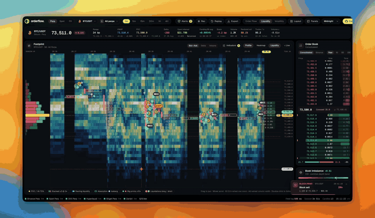
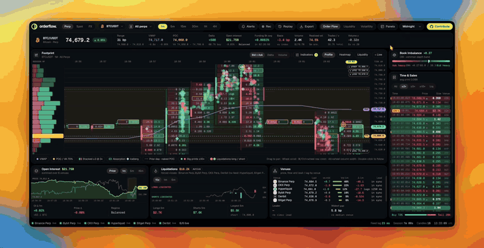
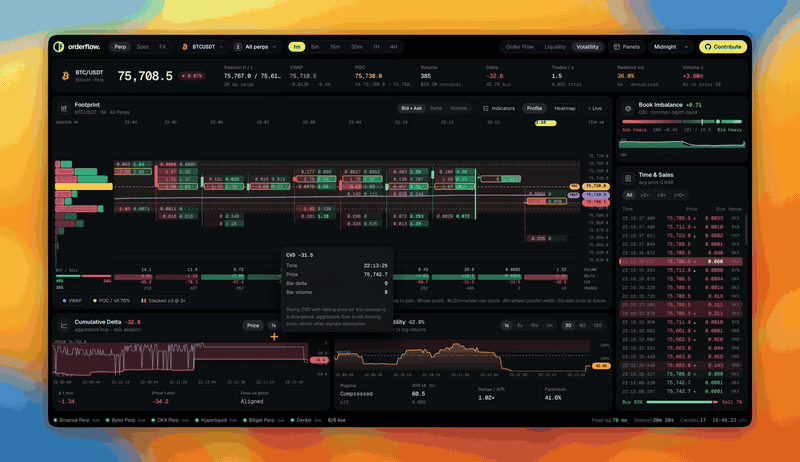

# Order Flow Tracker

**v2.3** — venue logos on liquidation and block-print bubbles, 122 verified
coins plus gold and silver perps and 20 FX pairs, and custom grid layouts you
can save:



**v2.2** — resting-liquidity heatmap, absorption and iceberg markers, venues
comparison, prior-session levels, liquidations, open interest and funding,
alerts, replay and export:



**v2.1** — the redesigned terminal:



Order Flow Tracker is a real-time market data terminal for studying executed
volume, price distribution, liquidity, and market microstructure. It provides a
compact analytical workspace for crypto markets and selected foreign-exchange
pairs.

The application is an analysis and screening tool. It does not place trades,
manage orders, connect to brokerage accounts, or manage portfolios.

## Overview

The terminal combines live WebSocket market data with a normalized order-flow
engine. Exchange-specific payloads are converted into common trade and order
book structures before they are processed by the charts and analytics panels.

```text
WebSocket feeds
    -> market adapters
    -> normalized market data
    -> order-flow engine
    -> session store
    -> charts and analytics panels
```

## Features

### Indicators

The footprint's **Indicators** menu lets users configure, per browser:

- Session VWAP, optional ±1σ / ±2σ deviation bands, and VWAP colour
- Session POC, value area (60 / 70 / 80 %), session high / low, POC colour
- Imbalance highlighting and ratio (2× – 4×), stacked imbalances and minimum
  levels (2 – 5), candle POC, OHLC strip, summary rows and last-price line
- Big-print bubbles and their minimum size, and liquidation bubbles
  (perpetuals)

### Footprint chart

- Contiguous tick ladder sized automatically from the instrument price
  (≈1 bp for crypto, ≈1 pip for FX)
- Three cell modes: Bid × Ask, Delta, and Volume
- Per-level imbalance highlighting (≥3× by default) and stacked-imbalance bars
- Per-candle POC outline and OHLC strip
- Session VWAP path, session POC, VAH and VAL lines
- Summary rows: volume, delta, cumulative delta, and trade count
- Session volume profile attached to the same price ladder
- Big-print bubbles: trades at least 5× / 10× / 20× / 50× the session's
  average print, at their price and time, sized by notional
- Liquidation bubbles (ringed) at the liquidation price and time, sized by
  notional (red: longs liquidated, green: shorts liquidated)
- Follow mode for the live candle and last price, drag/wheel pan and zoom
- Device-pixel-ratio aware canvas rendering with synchronized crosshair

### Resting-liquidity heatmap

Order-book depth over time behind the footprint (**Liquidity** in the
footprint header; on by default in the Liquidity workspace).

- Sampled once a second from each selected venue's full in-memory book,
  summed across venues and bucketed to the footprint tick, within ±3% of mid
- Kept for two hours as typed-array snapshots; drawn from an offscreen grid
  (one pixel column per second, one row per tick) stretched into each candle
  column, so panning and zooming stay cheap
- Colour runs dark blue → cyan → yellow → white, scaled to the recent 98th
  percentile so walls stand out; hovering a footprint level shows its resting
  size
- Depth reach differs by venue, so the far rows reflect the deeper books:

| Venue | Depth source |
| --- | --- |
| Binance perp | Live top 20 plus a 1000-level REST snapshot every 5 s |
| Bybit perp | `orderbook.1000` |
| OKX | `books` (400 levels) |
| Bitget | `books` (full incremental book) |
| Coinbase spot | `level2` (full book) |
| Hyperliquid, Deribit, Binance spot | 20 – 50 levels |

Recordings store these snapshots, so a replayed heatmap matches the live one.

### Absorption and icebergs

Heuristic markers on the footprint (Indicators → Microstructure), also
available as alert rules:

- **Absorption** (outlined band with an `ABS` tag): in a 10-second window,
  aggressive volume at one price reached at least an average window's total
  volume and half of that side's flow, while price did not trade more than one
  tick through the level. Green: the bid held against selling; red: the offer
  held against buying
- **Iceberg** (ice-blue diamond): on one venue's book, more than 1.5× a
  level's displayed size traded against it, at least 10× the average print,
  and the level refilled to at least half its size

### Venues

A study comparing the selected venues (needs All perps or All spot): last
price against the median venue in basis points, share of the last minute's
volume, one-minute delta, and lead / lag — the lag (in 250 ms steps, up to
±2 s) at which a venue's price changes best correlate with the average of the
other venues over the last 2.5 minutes. The venue with the clearest positive
lead is named in the panel header.

### Prior-session levels

- Previous UTC day's POC, VAH, VAL and VWAP as long-dashed lines with `pPOC`,
  `pVAH`, `pVAL` and `pVWAP` tags
- Naked POCs from the last seven days — POCs no later day (or today so far)
  traded back to — as dotted lines tagged `nPOC MM/DD`
- Levels outside the visible ladder are pinned to the top or bottom edge with
  an arrow and their price
- Built from Binance 5-minute klines (perpetual or spot to match the market),
  so they cover full days from the first load. VWAP is exact (quote ÷ base
  volume); the profile spreads each bar's volume evenly across its range, so
  POC and value area are approximations. Not available for Forex

### Traded-volume heatmap

- Enabled by default in the Liquidity workspace; toggle it from the footprint header
- Shows the relationship between traded volume and price
- Uses a typed-array time and price grid internally
- Paints incremental updates to an offscreen canvas
- Clips intensity near the upper percentile so one large trade does not
  dominate the entire chart
- Uses the active terminal theme and a low-opacity overlay
- Combines venue data when an aggregate crypto selection is active

The heatmap represents executed volume. It is not a resting-order-book
visualization.

### Session profile and KPI strip

- Buy/sell split volume profile with value area (70%) shading and POC
- A single-row KPI strip: session range, VWAP (σ and distance), POC and value
  area, delta and buy share; on perpetuals, open interest with its 5-minute
  change and positioning regime, funding with a countdown to the next
  settlement (annualized rate and per-venue rates in the tooltip) and
  mark-vs-index basis; then volume, realized volatility, trades per second and
  volume z-score
- The strip never wraps: as it narrows, trades/s and volume z drop out first,
  then volume, realized volatility and basis; anything still too wide scrolls

### Order book

- Price ladder with per-level size bars and cumulative depth shading
- Consolidated (multi-venue) or primary-venue source
- Raw or grouped price levels
- Liquidity-wall highlighting, spread in price and basis points, microprice
- Crossed consolidated books are labelled instead of showing a negative spread
- Resting bid/ask balance meter

### Time & sales

- Newest-first tape with millisecond timestamps, tick direction and venue
- Size filters relative to the session average print (≥2×, ≥5×, ≥10×)
- Block prints highlighted by size
- Aggressor buy/sell split over recent prints
- Liquidations interleaved as tagged rows (`LIQ L` / `LIQ S`), with a
  liquidations-only filter on perpetual markets

### Order book imbalance

The OBI panel displays the relative balance between bid and ask liquidity:

```text
OBI = (bid liquidity - ask liquidity) / (bid liquidity + ask liquidity)
```

The value ranges from -1 to +1. Positive values indicate greater bid
liquidity, negative values indicate greater ask liquidity, and zero indicates
balance.

### Market depth

- Cumulative bid and ask step curves on a symmetric window around the mid
- Resting size within ±10 bp and bid/ask ratios at 10 bp and 25 bp
- Crosshair price inspection

### Cumulative delta

- Session CVD at 1s/5s/15s/1m resolution with price overlay
- One-minute CVD and price change with a divergence flag

### Volume z-score

Executed volume is bucketed into fixed 1-second flow bars and resampled to the
selected bar size. Each bar is scored against the **preceding** N bars:

```text
z = (Vₜ − mean(Vₜ₋ₙ … Vₜ₋₁)) / std(Vₜ₋ₙ … Vₜ₋₁)
```

This measures unusual participation. It is not a volatility measure. Earlier
versions showed a per-trade quantity z-score under a "Volatility" label. That
has been replaced by this time-bucketed volume z-score and a separate realized
volatility study.

### Realized volatility

- Rolling close-to-close realized volatility from log returns of fixed time
  bars, annualized (`RV = √(mean r²) · √(bars per year)`; 365-day year for
  crypto, 260-day year for FX)
- Session percentile and regime (compressed, normal, elevated, extreme)
- ATR(14) on footprint candles, live range relative to ATR, and Parkinson
  high-low volatility

### Liquidations (perpetuals)

Forced closes from the venues that publish a public liquidation stream:
Binance, Bybit, OKX and Deribit. Bitget and Hyperliquid do not publish one,
and the panel lists them as having no feed.

- Long liquidations (forced sells) above the zero line, short liquidations
  (forced buys) below, in quote notional per 15s / 1m / 5m bucket
- Price overlay, 5-minute long and short totals and the largest liquidation
- Quiet / Active / Cascade state; a cascade is a latest bucket at least 5× the
  median non-empty bucket
- Records older than 60 seconds on arrival (OKX replays its last known
  liquidation) and duplicates are discarded

### Open interest, funding and basis (perpetuals)

- Open interest summed across the selected perpetual venues, sampled once a
  second, with price overlay. The set of summed venues is fixed once every
  venue has reported (or after 15 seconds), so a slow venue does not add a
  step to the series
- Funding: the venue's native rate and interval for a single venue; for an
  aggregate, the open-interest-weighted rate restated to an 8-hour interval
  (Hyperliquid funds hourly, some Binance symbols every 4 hours)
- Basis: perpetual mark price relative to the venue's spot index, in basis
  points
- Positioning regime over a 1m / 5m / 15m window:

| Price | Open interest | Regime |
| --- | --- | --- |
| Up | Up | New longs |
| Up | Down | Short covering |
| Down | Up | New shorts |
| Down | Down | Long unwind |

Moves under 0.05% in price or 0.1% in open interest count as flat
("Balanced").

| Venue | Open interest | Funding | Mark / index | Liquidations |
| --- | --- | --- | --- | --- |
| Binance | REST poll (5s) | `markPrice` stream | `markPrice` stream | `forceOrder` stream |
| Bybit | `tickers` | `tickers` | `tickers` | `allLiquidation` |
| OKX | `open-interest` | `funding-rate` | `mark-price`, `index-tickers` | `liquidation-orders` |
| Bitget | `ticker` | `ticker` | `ticker` | — |
| Hyperliquid | `activeAssetCtx` | `activeAssetCtx` (hourly) | mark / oracle price | — |
| Deribit | `ticker` (USD, converted) | `funding_8h` | `ticker` | `liquidation` flag on trades |

Binance USD-M routes streams by category: trades, mark price and liquidations
are read from `/market/ws` and partial depth from `/public/ws`. The legacy
`/ws` route accepts subscriptions but delivers no data.

### Alerts

The **Alerts** menu (bell) turns rules on per browser:

| Rule | Fires when |
| --- | --- |
| VWAP cross | Price moves to the other side of the session VWAP |
| Value area edge | Price crosses VAH or VAL |
| Volume spike | A completed 5-second bar's volume z-score reaches 2σ / 3σ / 4σ |
| Stacked imbalance | A new stack appears in the live candle (Indicators ratio and size) |
| Block print | A print reaches 10× – 100× the session average |
| CVD divergence | The 1-minute CVD and price change disagree in sign (both moves material) |
| Large liquidation | A forced close of at least $100K / $250K / $1M (perpetuals) |
| Absorption | An absorption marker is confirmed (see below) |
| Iceberg | An iceberg marker is confirmed (see below) |

Crossing rules wait for 50 session trades and repeat at most once per cooldown
(10 s – 5 min). Alerts appear as toasts and in the menu's log, with an optional
chime (Web Audio) and optional browser notifications when the terminal is not
the focused window. With notifications on, the feed keeps running in a hidden
tab instead of pausing.

### Recording and replay

- **Rec** records the live normalized stream — every trade and liquidation,
  order-book snapshots (top 25 levels, twice a second per venue) and
  derivatives state (once a second per venue) — to this browser's IndexedDB in
  one-second chunks, up to two hours per recording
- Changing the symbol, venue or timeframe ends the recording; a recording cut
  short by closing the tab stays playable and is marked interrupted
- **Replay** lists saved sessions; playback feeds the events back through the
  same engine on a virtual clock at 1×, 5× or 20×, with pause, restart and
  click-to-seek (← / → step 10 s). The live feed is disconnected and the market
  pickers are locked until you exit
- Recording and replay keep running in a hidden tab

### Export

The **Export** menu downloads:

- CSV: footprint candles, footprint levels (bid / ask volume per price per
  candle), the session profile, time & sales (last 20,000 prints),
  liquidations and open interest — times in UTC ISO and epoch milliseconds,
  oldest first
- PNG: the footprint chart, or every chart panel composited into one image

### Workspace controls

- Crypto and Forex asset-class switching
- Crypto spot and perpetual market selection
- Supported venue selection for crypto
- Currency-pair selection for Forex
- Timeframe selection from one minute to four hours
- Workspace presets for order-flow, liquidity, and volatility workflows
- Theme selection (persisted in the browser)
- Panel visibility menu (persisted in the browser)
- Pointer-based panel resizing from visible borders
- Responsive single-column layout on smaller screens
- First-visit bug-report dialog with issue and direct-message options

## Supported markets

### Crypto instruments

29 USDT pairs: BTC, ETH, XRP, BNB, SOL, DOGE, TRX, ADA, HYPE, LINK, SUI, AVAX,
BCH, LTC, DOT, UNI, NEAR, APT, AAVE, ETC, ENA, ATOM, ARB, OP, INJ, FIL, SEI,
TIA and WIF. Each is listed on Binance, Bybit, OKX, Bitget and Hyperliquid
(perpetual and spot where applicable) and Coinbase spot (except TRX). Deribit
covers BTC and ETH inverse perpetuals only. When a venue does not list the
selected coin it is left out of the aggregate automatically.

Coin and exchange logos are bundled in `public/coins` and `public/venues`
(from the MIT-licensed web3icons set). HYPE, ENA, INJ and WIF use a monogram
badge until official marks are added.

### Crypto perpetual markets

| Venue | Adapter status |
| --- | --- |
| Binance Futures | Supported |
| Bybit Futures | Supported |
| OKX Futures | Supported |
| Bitget Futures | Supported |
| Hyperliquid | Supported |
| Deribit | Supported |

### Crypto spot markets

| Venue | Adapter status |
| --- | --- |
| Binance Spot | Supported |
| Bybit Spot | Supported |
| OKX Spot | Supported |
| Bitget Spot | Supported |
| Coinbase Spot | Supported |

### Forex

Forex currently uses Finnhub as the internal data source. The provider is not
selectable in the user interface. Users choose only the currency pair.

Available pairs:

- EUR/USD
- GBP/USD
- USD/JPY
- AUD/USD
- USD/CAD

Forex subscriptions use Finnhub's OANDA symbol namespace internally. For
example, EUR/USD is subscribed as `OANDA:EUR_USD`.

## Forex data model

Finnhub's browser WebSocket stream provides Forex trade ticks but does not
provide a full exchange-native level-2 order book for these pairs. The
application therefore:

- Normalizes each tick into the common trade structure
- Classifies tick direction using price movement
- Builds a responsive bid and ask quote proxy for the shared book pipeline
- Derives OBI and depth visuals from that quote proxy
- Uses tick count as volume for the volume z-score ("tick volume")

Forex OBI and depth should therefore be interpreted as quote-flow indicators,
not as a complete view of all resting liquidity across the foreign-exchange
market.

Forex market hours are enforced using New York time. The application considers
the market open from Sunday at 17:00 through Friday at 17:00. When the market
is closed, the connection status reports the closed state and stale quotes are
not passed into analytics.

## Requirements

- Node.js 20 or newer
- npm
- A Finnhub API key for Forex mode
- Network access to the selected WebSocket market-data feeds

Crypto adapters may require additional exchange-specific configuration as the
project evolves. Review the adapter and venue configuration files before
deploying a new venue.

## Installation

Clone the repository and install dependencies:

```bash
git clone https://github.com/zadescoxp/order-flow-screener.git
cd order-flow-tracker
npm install
```

## Environment configuration

Create a local environment file:

```bash
cp .env.example .env.local
```

If `.env.example` is not present in your checkout, create `.env.local`
manually and add:

```bash
NEXT_PUBLIC_FINNHUB_API_KEY=your_finnhub_api_key
NEXT_PUBLIC_SITE_URL=https://your-domain.example
```

`NEXT_PUBLIC_SITE_URL` sets canonical links and the absolute URLs of the
Open Graph and X/Twitter share images (rendered from `app/opengraph-image.tsx`
and `app/twitter-image.tsx`). On Vercel it is detected automatically.

Never commit `.env.local`, API keys, or other credentials. The key is exposed
to the browser because the Finnhub stream is opened from the client. Use a
restricted development key and follow Finnhub's account and usage policies.

More Forex-specific details are available in
[docs/forex_setup.md](./docs/forex_setup.md).

## Development

Start the development server:

```bash
npm run dev
```

Open [http://localhost:3000](http://localhost:3000).

Create a production build:

```bash
npm run build
```

Start the production server after building:

```bash
npm run start
```

Run the test suite:

```bash
npm test
```

Run the linter:

```bash
npm run lint
```

## Docker

The `Dockerfile` builds a production image and runs `next start` as the
unprivileged `node` user on port 3000. Application config is unchanged.

`NEXT_PUBLIC_FINNHUB_API_KEY` and `NEXT_PUBLIC_SITE_URL` are inlined when the
image is built. Changing them later requires a new build. Restarting the
container does not change them. Leave the Finnhub key empty to run crypto
mode only. Set `NEXT_PUBLIC_SITE_URL` to the public origin you will open in
the browser, including the port if it is not 80 or 443. That value is used
for canonical links and share-image URLs.

The image does not read `.env.local`. Those files stay out of the build
context. Pass the values as build arguments. Do not push an image that
contains a real Finnhub key to a public registry. The key is part of the
client bundle, the same as in a normal production build.

Build and run with the values from `.env.local`:

```bash
set -a
. ./.env.local
set +a

docker build \
  --build-arg NEXT_PUBLIC_FINNHUB_API_KEY \
  --build-arg NEXT_PUBLIC_SITE_URL \
  -t order-flow-tracker .

docker run --rm -p 3000:3000 order-flow-tracker
```

`--build-arg NAME` with no `=` uses the variable already exported in the
shell. A build with neither variable set still succeeds. Forex stays
disabled, and the site URL defaults to `http://localhost:3000`.

Open [http://localhost:3000](http://localhost:3000).

To publish the container on another port, set `PORT` and map that same port:

```bash
docker run --rm -p 8080:8080 -e PORT=8080 order-flow-tracker
```

The base image is `node:22-alpine`, which satisfies the Node.js 20 or newer
requirement. Docker BuildKit is required because the build caches npm and
Next.js build files across runs. Docker Desktop enables BuildKit by default.

## Using the terminal

1. Choose Crypto or Forex in the Market selector.
2. Choose an instrument from the Instrument selector.
3. Select a timeframe.
4. For Crypto, choose a spot or perpetual market and venue. Forex uses the
   internal Finnhub source automatically.
5. Pick a workspace (Order Flow, Liquidity, Volatility), then fine-tune
   panels from the Panels menu.
6. In the footprint, switch cell modes, toggle the session Profile and the
   traded-volume Heatmap, and use Live (or double-click) to follow price.
7. Hover any chart, ladder row or print for details.
8. Drag panel borders to resize the studies dock, sidebar and sidebar panels.
9. Use the theme selector to change the visual theme without changing
   analytical behavior.

The connection status strip reports the current data-source state. If a feed
disconnects, the adapter retries with an increasing reconnect delay.

## Project structure

```text
app/
  page.tsx                 Application entry point
  globals.css              Global layout and theme styles

components/
  Terminal.tsx             Main terminal shell and panel layout
  TopBar.tsx               Market, workspace and panel controls
  MarketStatsBar.tsx       Session hero card (price and key stats)
  FootprintChart.tsx       Footprint, session profile, VWAP and heatmap
  OrderBook.tsx            Order-book ladder
  OBIPanel.tsx             Order-book imbalance gauge and history
  TimeAndSales.tsx         Time & sales tape
  CVDPanel.tsx             Cumulative volume delta
  VolumeZScorePanel.tsx    Volume z-score study
  VolatilityPanel.tsx      Realized volatility, ATR and Parkinson
  OpenInterestPanel.tsx    Open interest, price overlay and regime
  LiquidationsPanel.tsx    Liquidations per bucket and cascade state
  DepthOfMarket.tsx        Cumulative depth chart
  StatusBar.tsx            Feed health, lag and clock
  Logo.tsx                 orderflow mark, wordmark and GitHub icon
  AssetLogo.tsx            Coin and venue logos with monogram fallback
  IndicatorsMenu.tsx       Footprint indicator settings
  AlertsMenu.tsx           Alert rules, delivery and log
  AlertToasts.tsx          Alert toasts
  RecordingsMenu.tsx       Record button and saved-session list
  ReplayBar.tsx            Replay transport (play, speed, seek, exit)
  ExportMenu.tsx           CSV and PNG export
  VenuesPanel.tsx          Cross-venue price, flow and lead / lag
  ui/                      Shared primitives (cards, pills, menus) and icons

hooks/
  useCanvas.ts             DPR-aware canvas hook and theme palette
  useNow.ts                Ticking clock for countdowns and rolling windows
  useMarketNow.ts          Wall clock live, virtual clock during replay
  useAlerts.ts             Builds alert snapshots and delivers alerts
  usePriorSessions.ts      Fetches klines for prior-session levels

lib/config/
  instruments.ts           Crypto instrument catalog and logo map

lib/adapters/
  exchanges.ts             Crypto adapters and adapter factory
  binanceFutures.ts        Binance USD-M adapter (market + public routes)
  forex.ts                 Finnhub Forex adapter
  capabilities.ts          Venue and symbol capability checks

lib/engine/
  orderFlowEngine.ts       Candle, footprint, volume profile and OBI logic
  analytics.ts             Flow bars, volume z-score, realized volatility,
                           ATR, Parkinson, session VWAP and tick sizing
  alerts.ts                Alert monitor and CVD divergence
  imbalance.ts             Imbalance and stacked-imbalance rules
  depthHistory.ts          One-second resting-liquidity snapshots
  microstructure.ts        Absorption and iceberg detectors
  venues.ts                Per-venue buckets and lead / lag
  priorSessions.ts         Prior-day levels and naked POCs from klines
  derivatives.ts           Open interest, funding, basis, regime and
                           liquidation aggregation

lib/managers/
  marketDataManager.ts     Adapter lifecycle and analytics dispatch

lib/store/
  terminalStore.ts         Session market data and terminal settings
  uiStore.ts               Shared UI settings
  alertStore.ts            Alert settings (persisted) and log

lib/recording/
  recorder.ts              Writes the event stream to storage in chunks
  player.ts                Replays a recording on a virtual clock
  storage.ts               IndexedDB storage (in-memory for tests)

lib/render/
  liquidityHeatmap.ts      Offscreen grid renderer for the depth heatmap

lib/export/
  csv.ts                   CSV builders
  download.ts              Downloads and canvas snapshots

docs/
  forex_setup.md            Forex connection and symbol details

Dockerfile                   Production image
.dockerignore                Files excluded from the image build
```

## Design and implementation notes

The application uses a per-session market store so the terminal can process
live market data without putting exchange-specific state directly into
presentational components. The manager batches high-frequency updates before
dispatching them to the store.

Canvas-based panels use `ResizeObserver` to adapt to their containing panel.
Panel resizing is handled by pointer-driven split handles, with minimum and
maximum dimensions to keep the analytics readable.

Theme colors are defined as CSS variables and are reused by charts, panels,
heatmaps, status indicators, and controls.

## Troubleshooting

### The connection stays in an error state

Check the browser console and confirm that `.env.local` contains a valid
`NEXT_PUBLIC_FINNHUB_API_KEY` for Forex mode. Restart the development server
after changing environment variables.

### Forex prices are not updating

Confirm that the selected pair is one of the supported pairs and that Forex
market hours are open. The terminal does not process stale ticks while the
market is closed.

### OBI or depth appears limited in Forex mode

Finnhub provides trade ticks rather than a complete level-2 Forex order book.
Forex depth and OBI are therefore derived from the normalized quote proxy
described in the Forex data model section.

### A panel is not visible

Check the active workspace and the Panels menu. Panel choices are saved in the
browser, so clear the `oft-ui-preferences` local-storage key to restore the
defaults.

### The layout looks incorrect after a browser resize

Reload the page after resizing the browser window. Canvas panels use
`ResizeObserver` and will recalculate their dimensions when their containers
change.

## Contributing

Contributions are welcome. Before opening a pull request:

1. Create a focused feature branch.
2. Keep changes limited to the relevant feature or bug.
3. Run the test suite, build, and linter.
4. Explain data-source or analytics changes in the pull request description.
5. Do not include credentials, generated build output, or local environment
   files.

For bugs, include the selected market, venue or currency pair, timeframe,
browser, reproduction steps, and relevant console errors. Do not include API
keys in reports.

## License

Apache License 2.0.
